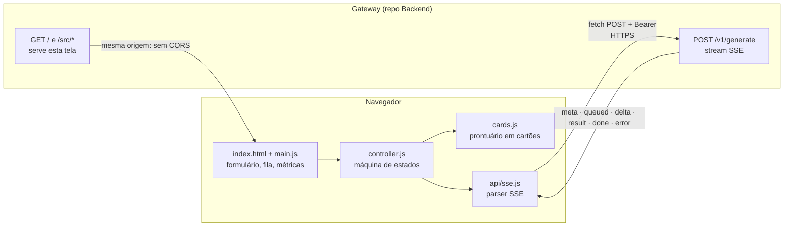
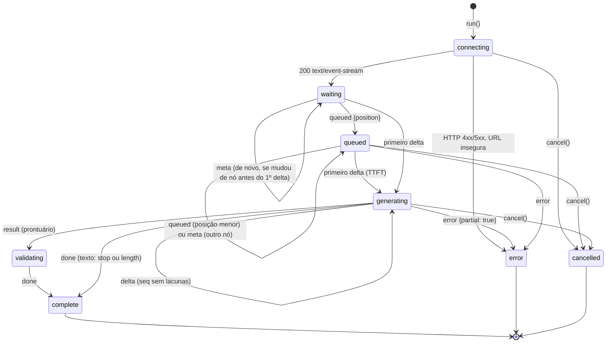

# Explicação do código — Frontend

A tela é HTML, CSS e JavaScript nativo (ES modules), sem framework e sem dependências. Ela fala só com a API pública do
Backend: não sabe de nós, modelos ou filas, a não ser pelo que os eventos SSE contam. A seção 1 mostra em diagramas
como ela se encaixa; a partir da seção 2, o código é explicado arquivo por arquivo.

## 1. Diagramas

### 1.1 Onde a tela fica no sistema

O `lab.py` do Backend sobe o gateway com `gateway.frontend_dir` apontando para este repositório: a tela abre em
`https://127.0.0.1:8443` e usa a própria origem como URL da API, sem CORS. Para desenvolver só a tela, também dá para
servir `dist/` com um servidor estático separado; aí a origem da página precisa estar em `gateway.cors_origins` e a URL
do gateway é informada na tela (ver o README).

### 1.2 A máquina de estados de um pedido (`controller.js`)

Qualquer evento fora dessa ordem (delta antes do meta, `meta` repetido sem mudar de nó, `done` sem `result` no
prontuário, evento desconhecido, stream que acaba sem terminal) leva ao estado `error`. A tela nunca mostra como
concluído um resultado incoerente.

### 1.3 O que a tela mostra

| Parte | De onde vem |
|---|---|
| "Posição na fila do nó X: 2º" | Evento `queued {position, node}` |
| request_id, domínio, modelo, nó, tentativas | Evento `meta` (o último) |
| Texto aparecendo aos poucos | Eventos `delta`, só como texto (`textContent`) |
| Métricas: TTFT e latência | Medidas **no navegador** (`performance.now()`) |
| Métricas: tokens e tokens/s | `done.completion_tokens`, contados pelo runtime |
| Cartões do prontuário | Evento `result` (JSON já validado pelo gateway), montado em `cards.js` |

### 1.4 Perguntas de entrevista

| Pergunta | Resposta curta |
|---|---|
| Por que `fetch` + parser próprio, e não `EventSource`? | O `EventSource` só faz GET e não manda o header `Authorization`. O pedido é um POST com corpo e token |
| Por que conferir a ordem dos eventos no cliente? | A tela não pode mostrar como concluído algo que o protocolo não garantiu (por exemplo, `done` sem `result` válido) |
| Como o TTFT é medido aqui? | Do início do `fetch` até o primeiro `delta` com texto; inclui rede, TLS e fila |
| Como evitam XSS com texto de um modelo? | Tudo entra por `textContent`; nenhum `innerHTML`. A CSP também só permite scripts da própria origem |
| O que acontece no cancelar? | `AbortController` fecha a conexão; o gateway detecta a desconexão e libera a vaga do pedido |

## 2. `index.html` — estrutura e política de segurança

- `<!doctype html>` e `<html lang="pt-BR">`: documento HTML5 com idioma declarado para acessibilidade e ferramentas assistivas.
- `<meta charset>` e viewport: Unicode e layout adaptável a telas móveis.
- `referrer=no-referrer`: não envia a página de origem em navegação/referrals.
- CSP: por padrão restringe recursos à própria origem; `connect-src` permite a API HTTPS e os endpoints HTTP locais de desenvolvimento; scripts e estilos só vêm da origem própria; objetos/plugins são bloqueados.
- Título, CSS e `<script type="module">`: carrega o estilo e inicia `src/main.js` como módulo ES.
- Cabeçalho: identifica o gateway acadêmico e avisa que extração não é diagnóstico ou recomendação.
- Seção Conexão: URL do Backend, checkbox explícito para confiar em uma origem HTTPS remota, token Bearer e botão logout/limpeza. O token é input password e fica apenas em memória no navegador.
- Formulário: seleção de domínio (`redes`, `prontuario`; a opção `auto` saiu porque o roteador está desligado por padrão), texto (até 8.000 caracteres, o limite do gateway), arquivo `.txt`, aviso para usar somente dados sintéticos e botões enviar/cancelar/retry.
- Seção de resultado: região `aria-live` anuncia o estado; `#queue` mostra a posição na fila; `<dl id="meta">` recebe os metadados; `<pre>` mostra a geração; `<dl id="metrics">` mostra as métricas do pedido; `#cards` recebe os cartões do prontuário; o botão de download começa desativado.

## 3. `src/main.js` — DOM e interações

- Importa `createController` e define `$` como atalho para `document.getElementById`.
- `form`, `output` e `finalResult`: guardam referências a elementos e o resultado exportável atual.
- Criação do controller:
  - `onState(state)` converte os estados em status em português e habilita ou desabilita cancelar e tentar de novo. Em `queued`, mostra a posição na fila. Em `waiting`, `queued` e `generating`, mostra os metadados. Em `complete`, mostra o painel de métricas (`renderMetrics`) e, se houver prontuário validado, os cartões (`renderProntuario`).
  - `onEvent({event,data})` acrescenta `delta.text` usando `textContent`, guarda `result` estruturado e limpa resultado no evento error. Não injeta HTML produzido pelo modelo.
- `renderPairs` / `renderMeta(meta)`: limpam o `<dl>` e criam `<dt>/<dd>` por DOM com `textContent`. Mostram request ID, domínio, modelo, nó, tentativa e os nós já tentados.
- `renderMetrics(state)`: TTFT e latência medidos no navegador; tokens do `done` (ou "não informado pelo runtime"); tokens/s = tokens ÷ (latência − TTFT); "cortada no limite de tokens" quando `finish_reason` é `length`.
- A URL do Backend começa com `location.origin` quando a tela é servida pelo gateway.
- `submit`:
  1. evita navegação normal do formulário e limpa dados da execução anterior;
  2. lê texto e arquivo escolhido;
  3. exige um dos dois, valida extensão/tamanho de 64 KiB e decodifica arquivo UTF-8 estrito;
  4. confere bytes UTF-8 e limite de 8.000 caracteres;
  5. chama `controller.run` com URL, token, domínio e confirmação de origem.
- Mudança na URL desmarca confiança anterior para impedir que a confirmação de uma origem seja reaproveitada para outra.
- Botão Cancelar chama `controller.cancel()`.
- Retry limpa preview, metadados e exportação antes de `controller.retry()`; usa a última entrada somente enquanto a sessão estiver ativa.
- Logout aborta/limpa controller, apaga token e confirmação, limpa conteúdo e desabilita download.
- Download serializa somente `finalResult.data` para JSON e cria um link temporário `Blob`; a URL de objeto é revogada após disparar o clique.

## 4. `src/api/sse.js` — parser incremental SSE

- `parseSSE(body)` recebe o `ReadableStream` HTTP, obtém reader e cria `TextDecoder` UTF-8 fatal: bytes malformados geram erro, em vez de substituição silenciosa.
- `buffer`, `event` e `data`: acumulam texto entre chunks, nome do evento corrente e linhas `data:`.
- `dispatch()`: se não há dados, reseta evento e não emite nada; caso contrário, junta linhas `data` com newline e devolve `{event,data}`.
- Loop de leitura: decodifica cada chunk preservando sequências UTF-8 divididas, procura delimitadores LF/CRLF/CR, preserva um CR final de chunk até o próximo pedaço e processa linhas completas.
- Linha vazia fecha um frame e dispara `dispatch`; comentário `:` é heartbeat e ignorado; outras linhas parseiam nome/campo, removem um espaço opcional após `:` e armazenam somente `event` e `data`.
- No EOF não tenta transformar buffer/frame parcial em evento: SSE exige delimitador em branco final para ser considerado completo.
- `finally`: tenta cancelar o reader (por exemplo após terminal) e libera o lock mesmo em exceção.

## 5. `src/features/generation/controller.js` — transporte e máquina de estados

- `createController({onState,onEvent})`: cria estado privado para requisição ativa, retry e `epoch` local. `epoch` funciona como geração da UI: callbacks de uma execução substituída são descartados.
- `run(params)`:
  - aborta tentativa anterior, incrementa epoch, cria `AbortController`, memoriza os parâmetros para retry e inicializa flags de protocolo/medição;
  - define wrappers `state`/`event` que só chamam a UI se o epoch continua atual;
  - valida URL absoluta: permite HTTPS geral e HTTP somente loopback, rejeita userinfo, query, fragment, caminho não raiz e origem remota sem confirmação explícita;
  - faz POST a `/v1/generate` com JSON, Bearer, `Accept: text/event-stream`, `redirect: error` e `AbortSignal`;
  - para HTTP não-2xx, tenta ler JSON de erro, comunica status/Retry-After e termina em estado de erro;
  - exige body e Content-Type SSE, guarda header `X-Request-ID`, depois processa frames completos;
  - `meta`: deve ser o primeiro evento, com request ID, domínio, modelo, nó e tentativa válidos, e concordar com o header. Pode vir **de novo** antes do primeiro delta, com o mesmo request ID e `attempt` maior (o pedido mudou de nó: failover ou migração da fila);
  - `queued`: depois do meta e antes do primeiro delta, com `position` inteiro ≥ 1 e `node`; vira o estado `queued` com a posição;
  - `delta`: só após meta e antes de result, exige texto e `seq` começando em 1 sem lacunas; primeiro texto não vazio marca TTFT; envia o fragmento ao callback;
  - `result`: só em execução com schema, único e compatível com o schema da meta; guarda payload para download posterior;
  - `done`: valida request ID, finish `stop` (ou `length` em texto, quando a resposta foi cortada no limite de tokens; no prontuário, só `stop`), contagem de tokens (inteiro/null), origem da contagem e presença/ausência coerente de result. Depois do terminal, para a leitura; conclusão inclui E2E e TTFT;
  - `error`: exige meta anterior, campos do envelope e `partial` coerente com existência de deltas; encaminha erro e encerra sem download;
  - eventos desconhecidos, JSON malformado, sequência inválida, falta de terminal e frames incompletos causam estado de erro;
  - catch traduz aborto para cancelamento e outras exceções para erro; finally só limpa `active` se ainda for o controller dessa execução.
- `cancel()`: invalida epoch, aborta a rede e publica estado cancelado sem permitir callback atrasado modificar a UI.
- `retry()`: inicia uma resposta nova com parâmetros memorizados; não é replay transparente no Backend e a nova execução recebe sua própria identidade.
- `clear()`: invalida execução, aborta request e apaga referência que retém token/texto para retry.

## 6. `src/style.css` — apresentação

- `:root`: fonte, tamanho base e cores de texto/fundo.
- `body`/`main`: remove margem padrão e centraliza conteúdo com largura máxima e espaçamento.
- `section, form`: superfícies brancas, borda, raio e espaçamento para separar tarefas.
- `label`, `input`, `textarea`, `select`: controles em coluna, largura total, espaçamento e tipografia herdada.
- `button`: área clicável; disabled recebe aparência de inativo.
- `.warning`: aviso de uso seguro destacado.
- `pre`: preview com quebras, proteção visual contra linhas extensas e contraste escuro.
- `dl`/`dt`: grade simples para metadados e labels em negrito.
- `.queue`: faixa amarela da posição na fila.
- `.cards` / `.card`: grade responsiva dos cartões do prontuário.

## 7. Build, contrato e dependências

### `scripts/build.mjs`

Remove apenas `dist/` gerado, recria diretório e copia `index.html` e `src/`. Não compila/transpila, não empacota dependências e não altera arquivos-fonte.

### `package.json`

Marca pacote privado ES module, declara Node mínimo 20 e scripts `npm test` (Node test runner) e `npm run build`. Não há dependências npm de runtime.

### `contracts/public/v1/events.json` e README

O JSON Schema define formatos permitidos para payloads dos eventos públicos. O README explica a ordem (v1.1): meta, queued, meta de novo em troca de nó, deltas numerados, result na extração e um terminal só. O schema é uma cópia da fonte Backend; o script no Backend verifica igualdade byte a byte.

## 8. Testes

### `tests/sse.test.js`

- helper `stream(parts)` cria stream de bytes de fixtures.
- Testes verificam UTF-8 dividido entre chunks, CRLF, comentários, múltiplos `data`, rejeição de frame final sem delimitador e CRLF partido entre chunks.

### `tests/controller.test.js`

- `sseResponse(events)` gera resposta SSE sintética e header request ID; `withFetch` substitui fetch de modo temporário.
- Testes cobrem result→done, domínio texto, done sem meta/result, error antes de meta, sequência inválida, TTFT no primeiro delta não vazio, aborto de execução antiga, recusa de origem não confiável, HTTP remoto e userinfo.
- Contrato v1.1: `queued` com posição e `meta` repetido em troca de nó; `meta` repetido inválido é rejeitado; `length` conclui em texto e é rejeitado no prontuário.
- São testes Node com `fetch` simulado; não demonstram CORS/TLS/browser reais.

## 9. `src/features/generation/cards.js` — cartões do prontuário

- `el`, `card`, `list`, `pairs`: criam elementos só com `textContent`. O conteúdo vem de um modelo de linguagem e não
  é confiável, por isso nunca entra como HTML.
- `renderProntuario(data)`: monta cinco cartões a partir do schema `prontuario-v1` (paciente, sinais vitais,
  diagnósticos, medicamentos e alergias). Campo ausente aparece como "—"; `alergias: null` aparece como "não
  informado", que é diferente de lista vazia ("nenhuma").
